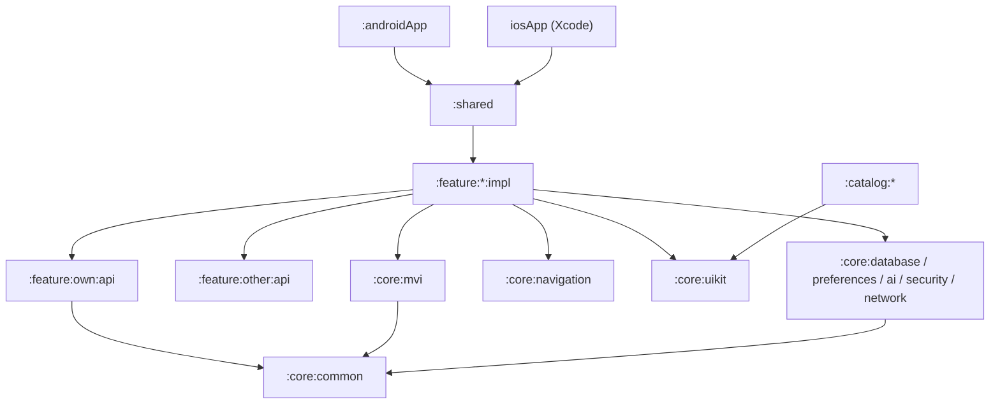

# Modules and the dependency graph

Repository directories:

```text
androidApp/          iosApp/           shared/
catalog/{shared,android,desktop}
core/{common,mvi,navigation,uikit,database,preferences,security,network,ai,testing}
feature/{onboarding,ledger,insights,scanner,assistant,settings}/{api,impl}
tooling/architecture-tests
server/              # Stage 6, a separate Gradle build
```

Stage 1–5 features: `onboarding`, `ledger`, `insights`, `scanner`, `assistant`, `settings`. The cloud stage adds `account`.

A feature Gradle path is `:feature:<name>:api` and `:feature:<name>:impl`. That is not a flat path. The `api` and `impl` modules share a project name, so each feature gets its own `group`, or the klib names conflict. Example group: `com.lebakin.finpulse.feature.ledger`.

Packages:

- impl: `com.lebakin.finpulse.feature.<name>`
- api: `com.lebakin.finpulse.feature.<name>.api`
- core: `com.lebakin.finpulse.core.<name>`

## Who depends on whom



## Rules

- `impl` does not depend on another feature's `impl`.
- `api` depends only on `:core:common` and kotlinx.
- `core` modules do not depend on features.
- `core.database` imports are allowed only in packages whose path contains `data`.
- `:shared` is the only place that sees every `impl`. The Koin graph and the root NavHost are assembled there.
- `:catalog` depends on `:core:uikit` and does not depend on features.

`checkModuleGraph` checks the dependency rules in this list. `:shared` may depend on a feature `impl` only through an `implementation` configuration, so other modules do not compile against it. The `core.database` import rule stays in Konsist. Run `scripts/check.sh checkModuleGraph`.

From Stage 3, `docs/project-map.md` is generated by `./gradlew projectMap` from the Gradle graph and the module cards. CI checks that the map matches the repository. Until the map exists, this file is the source of truth for the boundaries.
